<div align="center">

# 🛡️ DataOps AI-Powered Document Forensics & Contextual Intelligence System

**Next-Generation Multi-Spectral Visual Forensics, Cross-Document Correlation, and Court-Admissible Evidentiary Intelligence**

[](https://opensource.org/licenses/MIT)
[](https://www.iso.org/standard/53564.html)
[](https://csrc.nist.gov/publications/detail/sp/800-86/final)
[](https://nodejs.org/)
[](https://react.dev/)
[](https://tailwindcss.com/)
[](https://github.com/)

<p align="center">
  <a href="#-overview">Overview</a> •
  <a href="#-key-architectural-pillars">Pillars</a> •
  <a href="#-the-paradigm-shift">Comparison</a> •
  <a href="#-10-stage-forensic-pipeline">Pipeline</a> •
  <a href="#-interactive-workbench-modules">Modules</a> •
  <a href="#-quick-start">Quick Start</a> •
  <a href="#-rest-api-specification">API</a> •
  <a href="#-compliance--evidentiary-standards">Compliance</a>
</p>

</div>

---

## 🔬 Overview

In commercial banking, insurance claim adjudication, and government underwriting, sophisticated adversaries bypass traditional Optical Character Recognition (OCR) systems by crafting visually imperceptible digital modifications: **micro-spliced figures**, **inconsistent compression artifacts (ELA)**, **synthesized typography**, **biometric signature cloning**, and **cross-record financial contradictions**.

The **DataOps AI-Powered Document Forensics & Contextual Intelligence System** is an enterprise-grade forensic engine designed for Security Operations Centers (SOC), Fraud Investigation Units (FIU), and Risk Underwriters. Built on principles codified in **ISO/IEC 27037:2012** and **NIST SP 800-86**, the platform combines deep visual signal processing with cross-document contextual graph intelligence to expose multi-document synthetic fraud at sub-3-second latency.

```
                      ┌──────────────────────────────────────────────┐
                      │          Multi-Document Submission           │
                      │  (PDF, Scanned Raster, PNG, JPG, Contracts)  │
                      └──────────────────────┬───────────────────────┘
                                             │
                                   [Stage 1: Ingestion & SHA-256]
                                             ▼
                      ┌──────────────────────────────────────────────┐
                      │          Document Classification             │
                      │ (Identity, Bank Statement, Application Form) │
                      └──────────────────────┬───────────────────────┘
                                             │
                                   [Stage 2 & 3: Layout & OCR]
                                             ▼
                      ┌──────────────────────────────────────────────┐
                      │    OCR Token & Structural Extraction Engine  │
                      │   - Key-Value Extraction with Confidence %   │
                      │   - Normalized Bounding-Box Coordinates      │
                      └──────────────┬────────────────┬──────────────┘
                                     │                │
            ┌────────────────────────┴─┐            ┌─┴────────────────────────┐
            │   Visual Forensic Engine │            │ Contextual Verification  │
            │  - Error Level Analysis  │            │  - Arithmetic Validation │
            │  - Glyph Weight Mismatch │            │  - Chronological Logic   │
            │  - Signature Morphology  │            │  - Cross-Doc Linkage     │
            └────────────┬─────────────┘            └─────────────┬────────────┘
                         │                                        │
                         └───────────────────┬────────────────────┘
                                             │
                                   [Stage 7 & 8: Anomaly Synthesis]
                                             ▼
                      ┌──────────────────────────────────────────────┐
                      │     Multi-Factor Heuristic Risk Scoring      │
                      │     Interactive Evidence Canvas (Spotlight)  │
                      └──────────────────────┬───────────────────────┘
                                             │
                                   [Stage 9 & 10: Dossier & Chain]
                                             ▼
                      ┌──────────────────────────────────────────────┐
                      │    ISO/IEC 27037 Investigation Dossier       │
                      │    Exportable to PDF, JSON & Audit Ledger    │
                      └──────────────────────┴───────────────────────┘
```

---

## ⚡ The Paradigm Shift: Traditional OCR vs. Contextual Forensics

Legacy Identity Verification (IDV) and Intelligent Document Processing (IDP) solutions inspect text values in isolation. The table below illustrates the critical security gap bridged by this platform:

| Assessment Vector | Traditional OCR / IDV Gateways | DataOps Contextual Forensic Engine |
|:---|:---|:---|
| **Inspection Scope** | Single document evaluated in isolation | Multi-document relational graph correlation |
| **Tamper Detection** | Only detects altered text if OCR fails to read it | **Error Level Analysis (ELA)** & DCT quantization gradient analysis |
| **Typography & Fonts** | Discards font metrics; extracts ASCII text only | Sub-pixel kerning, glyph stroke weight & baseline pitch inspection |
| **Signature Verification** | Binary presence check ("Is a signature box filled?") | Vector morphology & **cosine stroke similarity** (cloning detection) |
| **Financial Consistency** | Parses nominal income string | **Automated mathematical ledger reconciliation** ($Balance_t = Balance_{t-1} + Cr - Dr$) |
| **Chronological Audit** | Validates Date formats (`YYYY-MM-DD`) | Cross-checks entity age against statutory limits and historical records |
| **Legal Admissibility** | Simple PDF export without cryptographic custody | **ISO/IEC 27037:2012** immutable dossier with SHA-256 chain of custody |
| **Explainability** | Black-box boolean approval (`PASS` / `FAIL`) | **AI Forensic Copilot** citing specific evidentiary coordinates & standards |

---

## 🌟 Key Architectural Pillars

### 1. 🔍 Multi-Spectral Visual Forensics (Pixel & Compression Layer)
- **Error Level Analysis (ELA):** Calculates differential recompression deltas across Discrete Cosine Transform (DCT) matrix blocks. Digitally spliced numbers or inserted figures display distinctive high-luminance compression anomalies against the uniform substrate.
- **Glyph Pitch & Font Inconsistency:** Detects digital text injection into scanned physical forms by analyzing glyph stroke density, antialiasing patterns, and baseline misalignment.

### 2. ✍️ Biometric Signature Vector Morphology
- **Cut-and-Paste Electronic Forgery Detection:** Natural hand-drawn signatures exhibit biological micro-tremor and stroke variation across signings. The engine computes cosine vector similarity on stroke paths: two signatures matching with $\ge 99.8\%$ mathematical identity indicate cloned copy-paste electronic forgery.

### 3. 🕸️ Contextual Intelligence & Multi-Document Reconciliation
- **Entity Resolution Graph:** Automatically links applicant identities across disparate documents (e.g., Commercial Loan Application vs. Official Bank Statement vs. Government National ID Card).
- **Income Disparity Detection:** Detects aggressive revenue falsification by contrasting self-reported application earnings ($14,500.00/month) against genuine bank account inflows ($3,833.33/month) — identifying a **+278% inflation anomaly**.
- **Age Inversion & Date of Birth Splicing:** Uncovers digitally altered birth years on identity credentials engineered to circumvent legal lending thresholds.

### 4. 🧮 Automated Mathematical Ledger Equation Validation
- Rebuilds financial statement transaction journals from raw OCR tabular tokens and verifies running balance integrity:
  $$\text{Ending Balance}_t = \text{Beginning Balance}_{t-1} + \sum \text{Credits} - \sum \text{Debits}$$
- Exposes fabricated balance statements where closing figures fail to reconcile arithmetically with line-item postings.

### 5. 📜 ISO/IEC 27037 Evidentiary Dossier & Chain of Custody
- Every uploaded document, intermediate feature tensor, and detected anomaly is cryptographically fingerprinted using **SHA-256**.
- Generates court-admissible forensic dossiers formatted according to forensic evidence preservation standards, complete with auditor timestamps, device hashes, and deterministic finding summaries.

### 6. 🤖 Neuro-Symbolic AI Forensic Copilot
- Grounded conversational assistant that allows investigators to query the case file in natural language (*"Why is the closing balance on Document 2 suspicious?"* or *"Explain the age inconsistency on the national identity card."*).
- Outputs citations mapped directly to evidentiary coordinates, confidence thresholds, and ISO standards.

---

## 🔄 10-Stage Forensic Pipeline

The platform runs a synchronized, ten-stage pipeline that transitions raw binary documents into verified legal intelligence:

```mermaid
flowchart LR
    S1[1. Ingestion & SHA-256] --> S2[2. Document Taxonomy]
    S2 --> S3[3. High-Res OCR Extraction]
    S3 --> S4[4. Layout & KV Parsing]
    S4 --> S5[5. Visual Forensics & ELA]
    S5 --> S6[6. Contextual Verification]
    S6 --> S7[7. Multi-Doc Cross Correlation]
    S7 --> S8[8. Risk Matrix Synthesis]
    S8 --> S9[9. Evidence Spotlight Mapping]
    S9 --> S10[10. ISO/IEC 27037 Dossier]
```



1. **Stage 1 — Ingestion & Cryptographic Hashing:** Computes SHA-256 hashes immediately upon receipt to guarantee evidence immutability.
2. **Stage 2 — Document Classification:** Identifies document genres (National ID, Bank Statement, Commercial Credit Application, Invoice).
3. **Stage 3 — OCR Tokenization:** Extracts text tokens with individual word confidence percentages ($0-100\%$) and bounding boxes ($[x, y, w, h]$).
4. **Stage 4 — Structural Key-Value Layout:** Maps unstructured document streams into standardized semantic schemas.
5. **Stage 5 — Visual Forensics & ELA:** Executes compression analysis, edge resampling inspection, and glyph kerning evaluation.
6. **Stage 6 — Contextual Logic Check:** Runs single-document validation (mathematical ledger balancing, check-digit verification).
7. **Stage 7 — Multi-Document Correlation:** Reconciles cross-document attributes (Applicant Name, DOB, Income, Address, Signature Vectors).
8. **Stage 8 — Anomaly Risk Synthesis:** Aggregates findings into a unified, weighted severity score ($0.0 - 10.0$).
9. **Stage 9 — Interactive Evidence Mapping:** Links each identified anomaly directly to coordinates on the visual canvas.
10. **Stage 10 — Dossier Compilation:** Assembles the official ISO/IEC 27037 investigation report with chain of custody records.

---

## 🖥️ Interactive Workbench Modules

The frontend provides an investigator-first user interface built with **React 18**, **Tailwind CSS**, and **Recharts**:

| Module Route | Component | Purpose & Capabilities |
|:---|:---|:---|
| **`/`** | **Forensic Overview** | Real-time threat index, risk gauge, active case queue, and quick-launch inspection triggers. |
| **`/pipeline`** | **10-Stage Pipeline** | Interactive pipeline execution view with live stage progression, timing telemetry, and terminal output. |
| **`/inspector`** | **Visual Evidence Canvas** | Multi-layer canvas with Error Level Analysis (ELA) heatmap toggle, font discrepancy overlays, and bounding box spotlights. |
| **`/correlation`** | **Cross-Doc Matrix** | Relational graph linking identity and financial vectors across documents with income and ledger validations. |
| **`/dossier`** | **Investigation Dossier** | Formal evidentiary report view compliant with ISO/IEC 27037; one-click PDF generation and JSON export. |
| **`/audit`** | **Audit Trail & AI Copilot** | Cryptographic custody ledger with timestamped hashes and interactive conversational AI forensic analyst. |

---

## 🚀 Quick Start

### Prerequisites
- **Node.js**: `v18.0.0` or higher
- **Package Manager**: `npm` (included with Node.js)
- **OS**: Windows, macOS, or Linux

### Method A: One-Click Launch (Windows)
Double-click the bundled launcher in the repository root:
```cmd
run.bat
```
*This starts both the API server on `http://localhost:8000` and the web interface on `http://localhost:5173`.*

### Method B: Manual CLI Launch

#### 1. Clone & Configure
```bash
git clone https://github.com/KalaiScript/DataOps_hack.git
cd DataOps_hack
```

#### 2. Start the Backend API
```bash
cd backend
npm install
node server.js
```
*The backend API will initialize at `http://localhost:8000` with the pre-seeded forensic database.*

#### 3. Start the Frontend Forensic Workbench
```bash
cd ../frontend
npm install
npm run dev
```
*Open your browser and navigate to `http://localhost:5173`.*

---

## 📡 REST API Specification

The backend provides a RESTful API for integration into enterprise SOC, VAPT, or orchestration pipelines:

### 1. Ingestion & Pipeline Orchestration
```http
POST /api/pipeline/run
Content-Type: application/json

{
  "name": "Commercial Underwriting Audit - Investigation #8492",
  "targets": ["urn:document:loan-app-01", "urn:document:bank-stmt-02"],
  "scan_type": "full_forensic"
}
```
**Response (`202 Accepted`):**
```json
{
  "run_id": "run-b7a94f12",
  "status": "running",
  "stages_count": 10
}
```

### 2. Retrieve Forensic Dossier
```http
GET /api/reports/:id
```
**Response (`200 OK`):**
```json
{
  "id": "rpt-c049d1ef",
  "case_id": "CASE-2026-8492",
  "chain_of_custody_sha256": "e3b0c44298fc1c149afbf4c8996fb92427ae41e4649b934ca495991b7852b855",
  "composite_risk_score": 9.4,
  "verdict": "FRAUD_DETECTED",
  "executive_summary": {
    "total_anomalies": 4,
    "critical_severity": 3,
    "primary_violation": "Multi-Document Contextual Forgery and Biometric Cloning"
  }
}
```

### 3. Query AI Forensic Copilot
```http
POST /api/copilot/query
Content-Type: application/json

{
  "question": "What is the discrepancy between the reported income and bank records?",
  "case_id": "CASE-2026-8492"
}
```
**Response (`200 OK`):**
```json
{
  "answer": "Applicant claims a monthly income of $14,500.00 on Document 1 (Commercial Loan Application). Cross-document correlation against Document 2 (Verified Bank Statement) reveals recurring payroll credits totaling only $3,833.33/month, representing a +278% unverified income inflation.",
  "confidence": 0.994,
  "cited_evidence": ["f-001", "f-003"],
  "standard_reference": "NIST SP 800-86 Section 3.2"
}
```

---

## ⚖️ Compliance & Evidentiary Standards

The platform conforms strictly to international digital evidence and forensic guidelines:

- **ISO/IEC 27037:2012**: Guidelines for identification, collection, acquisition, and preservation of digital evidence. Implemented via deterministic SHA-256 custody tracking and read-only immutable storage.
- **ISO/IEC 27041 & 27042**: Assurance of digital forensic methods and analysis of electronic evidence.
- **NIST SP 800-86**: Guide to Integrating Forensic Techniques into Incident Response.
- **Ethical AI & Bias Mitigation**: The engine separates optical noise (e.g., thermal scanner blur, natural paper fold shadows) from intentional digital manipulation. In compliance with fair lending and insurance statutes, all automated outputs are structured as advisory intelligence for human investigators.

---

## 📂 Project Structure

```
d:\DataOps_hack\
├── backend/
│   ├── server.js              # Express REST API with forensic state engine
│   ├── main.py                # Optional FastAPI backend microservice
│   ├── requirements.txt       # Python dependencies (FastAPI, Pydantic, Uvicorn)
│   ├── package.json           # Node.js backend dependencies
│   ├── db.json                # Pre-seeded test case database
│   └── forensics_db.json      # Structured multi-doc forensic telemetry database
├── frontend/
│   ├── src/
│   │   ├── pages/
│   │   │   ├── Dashboard.jsx  # High-level forensic overview & telemetry
│   │   │   ├── Pipeline.jsx   # 10-Stage sequential execution tracker
│   │   │   ├── Findings.jsx   # Visual evidence canvas (ELA, fonts, signatures)
│   │   │   ├── RiskAnalysis.jsx # Cross-document correlation graph & matrix
│   │   │   ├── Reports.jsx    # Court-admissible ISO/IEC 27037 dossier
│   │   │   └── Scans.jsx      # Cryptographic audit trail & AI Copilot
│   │   ├── components/ui.jsx  # Reusable UI badges, meters, spotlight widgets
│   │   ├── api.js             # Axios client with REST endpoint bindings
│   │   ├── App.jsx            # Workbench layout & navigation
│   │   └── index.css          # Tailwind CSS layer definitions
│   ├── package.json           # Frontend dependencies (React 18, Vite, Lucide, Recharts)
│   ├── vite.config.js         # Vite bundler configuration
│   └── tailwind.config.js     # Cyber-forensic dark theme tokens
├── run.bat                    # One-click Windows development orchestrator
├── .gitignore                 # Exclusion rules for clean repository hygiene
└── README.md                  # Comprehensive technical documentation
```

---

## 👥 Authors & Contributors

- **Author**: DataOps Innovation Engineering Team
- **Track**: SOC | NOC | VAPT
- **Version**: `2.5.0`
- **License**: Distributed under the MIT License. See `LICENSE` for details.

<div align="center">
  <sub>Built for the DataOps Innovation Hackathon. Engineered for production-scale document security and forensic auditability.</sub>
</div>
